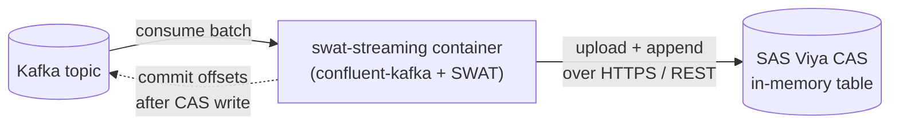

# SWAT Streaming Container

**swat-streaming** is a small, containerized bridge that consumes a Kafka topic and writes the messages into a SAS Viya CAS in-memory table using the [SWAT](https://sassoftware.github.io/python-swat/) Python client.

It is built for deployments where SAS Viya cannot subscribe to Kafka natively and you want streaming data available in CAS for downstream analytics: dashboards in SAS Visual Analytics, model scoring, or ad-hoc exploration in SAS Studio.

## Key features

- **Batching.** Messages are written to CAS in batches, triggered by size (`BATCH_SIZE`) or time (`BATCH_TIMEOUT_SECONDS`), so you don't pay CAS's per-call overhead for every message.
- **At-least-once delivery.** Kafka offsets are committed only after the batch has landed in CAS. A crash replays the batch; no message is silently lost.
- **Kafka lineage on every row.** Each row gets `_kafka_topic`, `_kafka_partition`, `_kafka_offset`, `_kafka_timestamp` and `_ingested_at` columns, which you can use for deduplication and auditing.
- **Secure by default.** SASL/SCRAM-SHA-512 over TLS for Kafka, OAuth bearer tokens for CAS, credentials read from mounted files instead of environment variables, and a non-root, read-only container.
- **Horizontal scaling.** Replicas share a Kafka consumer group, and partitions are rebalanced across pods automatically.
- **Built-in load generator.** A synthetic card-transaction producer with labeled fraud patterns ships in the same image, so you can test the pipeline end to end.

## What's in the repository

| Path | Purpose |
|---|---|
| `app/` | The consumer: Kafka source, message parser, CAS writer, and the batching loop |
| `producer/` | Synthetic Kafka producer (card-fraud transactions) for end-to-end testing |
| `Dockerfile` | Slim, non-root image that contains both the consumer and the producer |
| `requirements.txt` | Pinned Python dependencies |
| `k8s/` | Namespace, ConfigMap, Deployment, NetworkPolicy, producer Job, example Secret, Kustomization |
| `website/` | This documentation site |

## Where to go next

- [Architecture](architecture.md): how a message travels from Kafka to CAS, and the delivery guarantees.
- [Deployment](deployment.md): build the image and deploy it to Kubernetes.
- [Configuration reference](configuration.md): every environment variable the consumer and producer read.
- [Authentication](authentication.md): Kafka and CAS credentials, and how to deliver secrets to the pod.
- [Testing](testing.md): run the synthetic producer and verify data in CAS.
- [Operations](operations.md): scaling, persistence, schema changes, and troubleshooting.
- [Development](development.md): run locally and contribute.

## License

This project is licensed under the [Apache 2.0 License](https://github.com/sassoftware/swat-streaming/blob/main/LICENSE). As with any container image, direct and indirect dependencies are governed by their own licenses. Users of the published container image are responsible for making sure their use complies with all applicable licenses.
