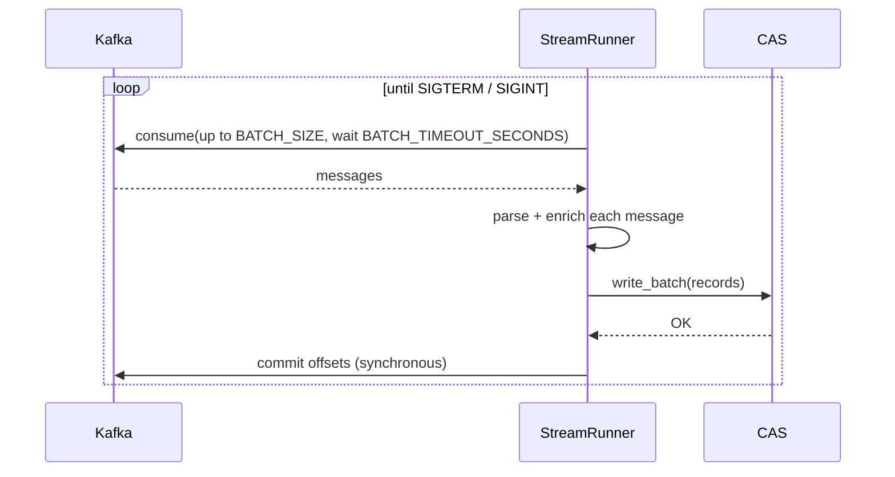
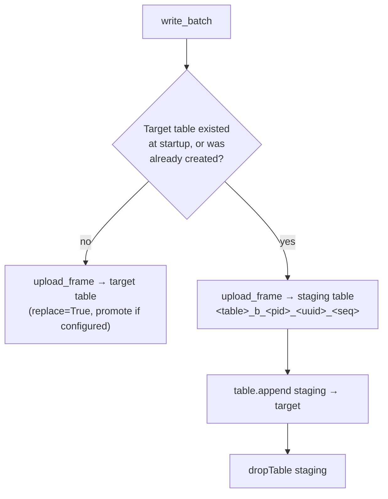

# Architecture

The consumer is a single-threaded loop with four building blocks:

| Module | Responsibility |
|---|---|
| `app/kafka_consumer.py` (`KafkaSource`) | Subscribes to the topic, polls batches, and commits offsets explicitly |
| `app/message_parser.py` | Decodes each payload (`json` or `raw`) and adds Kafka metadata columns |
| `app/cas_writer.py` (`CASWriter`) | Opens the CAS session and loads batches into the target table |
| `app/main.py` (`StreamRunner`) | Wires everything together, runs the loop, and handles shutdown signals |

All configuration comes from environment variables (`app/config.py`). See the [configuration reference](configuration.md).

## The batch loop



Each iteration:

1. **Poll.** Asks Kafka for up to `BATCH_SIZE` messages and waits at most `BATCH_TIMEOUT_SECONDS`. If nothing arrives, the loop polls again. Partition-EOF events are ignored; any other Kafka error stops the process.
2. **Parse.** Decodes every message according to `MESSAGE_FORMAT`:
   - `json`: the payload must be a UTF-8 JSON **object**. Each top-level key becomes a column.
   - `raw`: the payload is decoded as UTF-8 (invalid bytes are replaced) into a single `value` column.

   Messages that can't be parsed are logged as `Skipping unparseable message` and **skipped, but their offsets are still committed**. There is no dead-letter queue.
3. **Enrich.** Adds lineage columns to each record. If the payload already has a field with the same name, the payload value wins.

   | Column | Content |
   |---|---|
   | `_kafka_topic` | Source topic |
   | `_kafka_partition` | Source partition |
   | `_kafka_offset` | Offset within the partition |
   | `_kafka_timestamp` | Kafka message timestamp (epoch milliseconds) |
   | `_ingested_at` | UTC ISO-8601 timestamp of when the consumer processed the message |

4. **Write.** Builds a pandas DataFrame from the batch and loads it into CAS (see below).
5. **Commit.** Commits the highest offset per partition, synchronously, only after the write succeeded.

## CAS write strategy



- **First batch.** If the target table didn't exist when the CAS session was opened, the first batch creates it with `upload_frame`. When `CAS_TABLE_PROMOTE=true`, the table is promoted to global scope, so other CAS sessions (SAS Studio, Visual Analytics, and so on) can see it.
- **Later batches.** Each batch is uploaded to a uniquely named staging table and appended to the target with `table.append`. The staging table is then dropped, even if the append failed. Staging names include the process ID and a random suffix, so several replicas never collide.
- **Column types are fixed by the first batch.** `upload_frame` infers CAS column types from the DataFrame. Later batches must stay compatible with that schema. See [schema changes](operations.md#schema-changes).
- **Retries.** `write_batch` is retried on `SWATError` up to 5 times with exponential backoff (1 s to 30 s). If every attempt fails, the error propagates, the process exits with code 1, and Kubernetes restarts the pod. Because the offsets were never committed, the batch is replayed.

## Delivery guarantees

swat-streaming provides **at-least-once** delivery:

- A message's offset is committed only after its batch is in CAS, so a crash never loses data.
- A crash *after* the CAS write but *before* the commit replays the whole batch on restart, which creates duplicate rows.

Use `_kafka_topic` + `_kafka_partition` + `_kafka_offset` as a natural key to deduplicate downstream. Make sure consumers of the CAS table either tolerate duplicates or deduplicate on that key.

## Lifecycle and shutdown

1. Configuration is loaded and validated. A missing required variable exits immediately with code **2**.
2. The Kafka consumer subscribes and the CAS session connects. The writer records whether the target table already exists.
3. The loop runs until `SIGTERM` or `SIGINT`. In the container, `tini` is PID 1 and forwards signals to Python.
4. On shutdown, the current batch finishes, and then the Kafka consumer and CAS session are closed. If `CAS_PERSIST_ON_SHUTDOWN=true`, the in-memory table is saved to the caslib first (as `<table>.<CAS_PERSIST_FORMAT>`).

| Exit code | Meaning |
|---|---|
| `0` | Clean shutdown after a signal |
| `1` | Fatal runtime error (Kafka error, CAS write failed after retries, and so on) |
| `2` | Configuration error (required environment variable missing) |

## Logging

Every log line is a single JSON object on stdout, with `ts`, `level`, `logger` and `message` fields plus structured context:

```json
{"ts": "2026-05-27 10:42:13,812", "level": "INFO", "logger": "app.main", "message": "Batch processed", "received": 500, "written": 498, "parse_failures": 2}
```

The `kafka` and `swat` library loggers are capped at `WARNING`. Credentials are never logged. The CAS connection line only says `"auth": "token"` or `"auth": "password"`.
